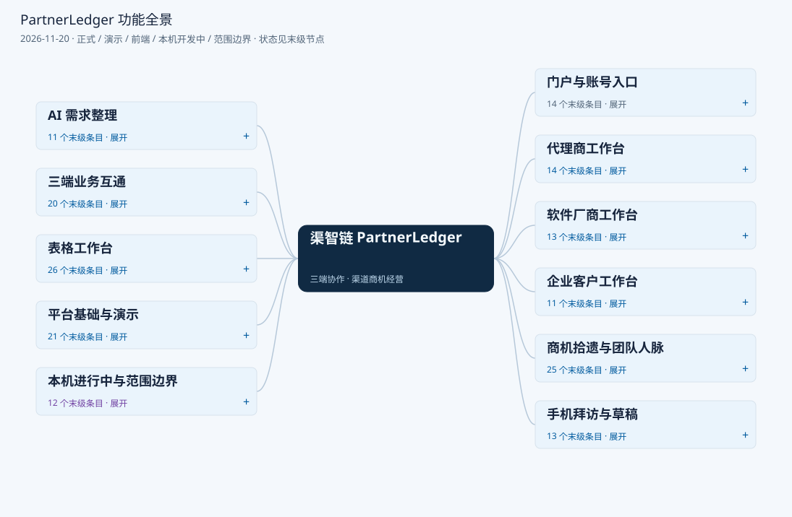

# PartnerLedger 全功能思维导图

核对日期：2026-11-20。已提交基线：`85e61e1`；另列当前工作树中未提交的功能。共 11 个主分支、185 个末级条目，条目包含功能、约束和边界，不代表独立模块数量。

[打开交互导图](features-mindmap.html) · [完整矢量图](features-mindmap.svg) · [概览图](features-mindmap-overview.svg) · [FreeMind 格式](features-mindmap.mm)

- 正式已接入指代码已连接真实 API，使用时仍需启动后端并配置数据库、账号与相关服务。
- 演示可用指本地样例流程，不表示正式业务接口已上线。
- 本机开发中来自当前工作树，未计入主分支已交付功能；本图不会提交这些业务代码。

状态：正式已接入 / 演示可用 · 正式待接 / 前端公共功能 / 本机开发中 / 范围边界。

```mermaid
mindmap
  root((渠智链 PartnerLedger))
    门户与账号入口 · 前端公共功能
      平台门户 · 前端公共功能
        平台价值与业务介绍 · 前端公共功能
        原创抽象动态视觉与减少动态效果适配 · 前端公共功能
        三方协作案例切换 · 前端公共功能
        商机拾遗场景介绍 · 前端公共功能
        关于平台与使用帮助 · 前端公共功能
      统一导航 · 前端公共功能
        解决方案与协作菜单 · 前端公共功能
        站内功能入口搜索 · 前端公共功能
        三种角色的统一登录入口 · 前端公共功能
        手机导航与弹层操作 · 前端公共功能
      组织账号 · 正式已接入
        代理商、软件厂商、企业客户登录 · 正式已接入
        按服务端组织类型核验入口 · 正式已接入
        查看个人资料与所属组织 · 正式已接入
        退出登录与会话失效处理 · 正式已接入
        刷新恢复会话并重新核验身份 · 正式已接入
      组织账号注册 · 正式已接入
        选择三类身份并填写组织名称、用户名和密码 · 正式已接入
        用户名格式、密码长度与重复用户名校验 · 正式已接入
        注册成功后返回登录 · 正式已接入
        注册频率限制与失败提示 · 正式已接入
        新客户业务协作仍需维护者建立代理关系 · 正式已接入
    代理商工作台 · 正式已接入
      工作总览 · 正式已接入
        可见项目、待我处理、协作方处理中统计 · 正式已接入
        项目待办直接打开对应记录 · 正式已接入
        产品、AI、拜访、商机常用入口 · 正式已接入
      客户项目台账 · 正式已接入
        选择已关联客户代录需求 · 正式已接入
        项目名称、需求与目标日期 · 正式已接入
        搜索项目编号或名称、状态筛选 · 正式已接入
        待我处理筛选与详情查看 · 正式已接入
      需求与厂商询价 · 正式已接入
        查看客户原始需求 · 正式已接入
        选择真实已发布产品 · 正式已接入
        手工编写或用本地规则整理摘要 · 正式已接入
        人工核对后提交厂商询价 · 正式已接入
        未处理询价可撤回 · 正式已接入
        向客户要求补资料、向厂商回复资料 · 正式已接入
        查看厂商附加能力缺口 · 正式已接入
    软件厂商工作台 · 正式已接入
      渠道供给 · 正式已接入
        本组织产品新增与编辑 · 正式已接入
        产品名称、版本与说明 · 正式已接入
        发布或撤下产品 · 正式已接入
        产品详情、已加载产品搜索与发布筛选 · 正式已接入
        目录分页继续加载 · 正式已接入
      询价办理 · 正式已接入
        待办统计与代理商询价队列 · 正式已接入
        查看询价摘要与所选产品 · 正式已接入
        要求代理商补充资料 · 正式已接入
        查看代理商回传资料 · 正式已接入
        标记暂不支持的附加需求 · 正式已接入
        主询价与能力缺口分别跟进 · 正式已接入
      报价与履约 · 演示可用
        分项渠道报价与改版 · 演示可用
        登记供货与授权交接记录 · 演示可用
    企业客户工作台 · 正式已接入
      采购需求 · 正式已接入
        选择已关联代理商提交需求 · 正式已接入
        填写项目名称、业务需求、目标日期 · 正式已接入
        查看采购项目列表与状态 · 正式已接入
        回复代理商提出的补充问题 · 正式已接入
        查看本人可见的项目资料与历史 · 正式已接入
      方案决策 · 演示可用
        查看对客方案、分项报价与版本 · 演示可用
        申请修改方案 · 演示可用
        确认指定有效版本报价 · 演示可用
      实施验收 · 演示可用
        跟踪供货与实施进度 · 演示可用
        提交验收意见并确认验收 · 演示可用
        退回整改并继续跟踪 · 演示可用
    商机拾遗与团队人脉 · 正式已接入
      留住附加需求 · 正式已接入
        关联主项目记录独立副需求 · 正式已接入
        先澄清成品接口、对接服务或插件等类型 · 正式已接入
        记录 ERP、MES、WMS、OA、CRM、IDE 系统范围 · 正式已接入
        主项目与商机分别留存、互相跳转 · 正式已接入
      团队伙伴与可信推荐 · 正式已接入
        登记伙伴能力、内部引荐人与合作依据 · 正式已接入
        按能力及源目标系统匹配 · 正式已接入
        优先显示有合作记录的候选 · 正式已接入
        显示推荐理由、局限及待核实信息 · 正式已接入
        明确显示待澄清、无人选或仅登记能力 · 正式已接入
        新伙伴反向唤回未解决旧需求 · 正式已接入
        团队共享经验，候选已读按成员记录 · 正式已接入
      联系前核对 · 正式已接入
        核对软件版本与接口开放条件 · 正式已接入
        核对实施地区与交付档期 · 正式已接入
        记录不匹配原因并排除候选 · 正式已接入
        存在阻碍项时限制引荐 · 正式已接入
        复制不含客户、预算、联系方式的询问摘要 · 正式已接入
      引荐与结果 · 正式已接入
        人工确认双方同意后登记引荐 · 正式已接入
        记录介绍费金额与结算条件 · 正式已接入
        约定客户答复、伙伴回访、费用核对日期 · 正式已接入
        今天及逾期待办回到对应商机 · 正式已接入
        登记已促成或未促成及原因 · 正式已接入
        人工登记介绍费已结清 · 正式已接入
        获授权的成交结果留作后续匹配依据 · 正式已接入
      能力缺口汇总 · 正式已接入
        按能力类型汇总团队副需求 · 正式已接入
        由缺口回到可见的相关记录 · 正式已接入
    手机拜访与草稿 · 正式已接入
      低成本记录 · 正式已接入
        一句话记下拜访内容 · 正式已接入
        立即保存或稍后关联客户项目 · 正式已接入
        用本地规则拆出主采购事项与附加需求 · 正式已接入
        人工修改并核对两类需求 · 正式已接入
      个人草稿同步 · 正式已接入
        草稿保存到当前成员账号 · 正式已接入
        同账号可继续读取和编辑 · 正式已接入
        列出、重开、编辑与删除已同步草稿 · 正式已接入
        草稿按成员隔离，同事不可读取原文 · 正式已接入
        选择旧本机草稿同步，保留原记录 · 正式已接入
      确认与继续办理 · 正式已接入
        显式确认后生成或复用独立商机 · 正式已接入
        跳转主项目或已关联商机 · 正式已接入
        确认附加需求不改写主项目 · 正式已接入
        响应不确定时保留原请求并重放核对 · 正式已接入
    AI 需求整理 · 正式已接入
      模型辅助提取 · 正式已接入
        调用后端 DeepSeek 解析脱敏描述 · 正式已接入
        提取企业类型、模块与部署方式 · 正式已接入
        员工人数与授权用户数分开提取 · 正式已接入
        显示缺失字段与追问 · 正式已接入
      人工兜底 · 正式已接入
        编辑并确认解析结果 · 正式已接入
        未知字段保留为空 · 正式已接入
        模型不可用时切换手工填写 · 正式已接入
        确认结果仅留在当前页面 · 正式已接入
      能力说明 · 范围边界
        真实解析需要后端模型密钥与服务可用 · 范围边界
        询价辅助整理和拜访拆分是本地规则 · 范围边界
        未实现自动联系人联络或自动商机决策 · 范围边界
    三端业务互通 · 正式已接入
      同一项目协作 · 正式已接入
        客户提需求 → 代理商收到待办 · 正式已接入
        代理商询价 → 厂商收到记录 · 正式已接入
        厂商补问 → 代理商向客户澄清 → 回传 · 正式已接入
        厂商标记缺口 → 代理商另找伙伴 · 正式已接入
        按角色显示进度、动作与事件时间线 · 正式已接入
        手动刷新、前台定时刷新与返回窗口更新 · 正式已接入
      两套报价 · 演示可用
        渠道报价与对客报价分别编号、留版本 · 演示可用
        数量、单价、服务明细、有效期、交付周期 · 演示可用
        报价总额与前版变化展示 · 演示可用
        修改报价保留旧版，过期或替代版本受限 · 演示可用
      交易与履约闭环 · 演示可用
        客户确认指定对客报价 · 演示可用
        代理商单独确认下单 · 演示可用
        有效版本校验与重复下单保护 · 演示可用
        厂商供货 → 代理商实施 → 客户验收 · 演示可用
        退回整改 → 再次提交验收 · 演示可用
      权限边界 · 正式已接入
        客户只看需求及对客资料 · 正式已接入
        厂商只看询价摘要等上游资料 · 正式已接入
        客户看不到渠道进价、折扣、毛利 · 正式已接入
        厂商看不到代理商对客售价 · 正式已接入
        人脉、拜访原文、介绍费仅代理商内部可见 · 正式已接入
    表格工作台 · 正式已接入
      创建与共享 · 正式已接入
        新建、打开与分页加载表格 · 正式已接入
        重命名表格和列 · 正式已接入
        增加行数与追加列 · 正式已接入
        通用、文本、数值、日期、布尔列 · 正式已接入
        仅自己、组织内只读、组织内可编辑 · 正式已接入
      编辑与计算 · 正式已接入
        A1 坐标跳转、双击或 F2 编辑 · 正式已接入
        键盘移动、Shift 扩选与清空 · 正式已接入
        从 Excel 粘贴、复制矩形区域 · 正式已接入
        撤销与重做 · 正式已接入
        A1 引用、四则运算与括号 · 正式已接入
        SUM、AVERAGE、MIN、MAX、COUNT · 正式已接入
        虚拟窗口读取与稀疏单元格存储 · 正式已接入
      查找替换 · 正式已接入
        全表查找、继续扫描与定位结果 · 正式已接入
        区分大小写与整格匹配 · 正式已接入
        可选检索公式原文 · 正式已接入
        替换预览、勾选后批量提交 · 正式已接入
        列类型不符提示、支持撤销替换 · 正式已接入
      保存与导出 · 正式已接入
        自动保存、立即保存及状态反馈 · 正式已接入
        刷新恢复未同步编辑 · 正式已接入
        冲突后显式重放或放弃本地改动 · 正式已接入
        同请求键重试与批次原子性 · 正式已接入
        CSV 导出与外部公式文本保护 · 正式已接入
      容量约束 · 范围边界
        可寻址上限 10 万行 × 128 列 · 范围边界
        单批写入或粘贴最多 250 格 · 范围边界
        CSV 单次最多 1 万行或 8 MiB 原始内容 · 范围边界
        公式单范围最多 256 格 · 范围边界
    平台基础与演示 · 正式已接入
      统一交互与组件 · 前端公共功能
        蓝白主题、角色导航与面包屑 · 前端公共功能
        按钮、卡片、统计、字段、状态标签、业务图标 · 前端公共功能
        角色协作进度条与组件展示页 · 前端公共功能
        响应式布局、手机导航抽屉 · 前端公共功能
        键盘焦点、Escape 关闭、减少动态效果 · 前端公共功能
        加载、空数据、无权限、错误和重试反馈 · 前端公共功能
      会话与数据保护 · 正式已接入
        组织及角色访问隔离 · 正式已接入
        状态及允许动作由服务端校验 · 正式已接入
        版本检查防止旧内容覆盖 · 正式已接入
        幂等请求防止重复写入 · 正式已接入
        不确定提交恢复与人工核对 · 正式已接入
        权限范围内记录时间线与业务审计 · 正式已接入
      维护与接口交接 · 正式已接入
        开通三类组织账号与客户代理关系 · 正式已接入
        数据库显式迁移与服务连通检查 · 正式已接入
        健康、就绪探测与模型配置 · 正式已接入
        OpenAPI、数据访问层及模块交接文档 · 正式已接入
      独立演示空间 · 演示可用
        三端 ERP 样例共享本地记录 · 演示可用
        切换演示身份与重置三端样例 · 演示可用
        正式记录与演示数据隔离 · 演示可用
        旧双角色原型独立保留 · 演示可用
        旧原型草稿、报价、订单与四节点交付 · 演示可用
    本机进行中与范围边界 · 本机开发中
      本机未提交开发 · 本机开发中
        拜访页直接预览团队伙伴推荐 · 本机开发中
        显示引荐人、合作依据和匹配局限 · 本机开发中
        调整能力类型与系统匹配条件 · 本机开发中
        复制面向内部引荐人的微信询问文案 · 本机开发中
        拜访确认携带匹配条件到现有商机接口 · 本机开发中
      正式待接入 · 演示可用
        正式渠道报价与对客报价 API · 演示可用
        正式订单、供货、实施与验收 API · 演示可用
      当前未提供 · 范围边界
        支付、开票与自动资金结算 · 范围边界
        自动发放真实软件授权码 · 范围边界
        自动发送微信消息或读取通讯录 · 范围边界
        开放供应商交易市场 · 范围边界
        完整组织成员管理与自助绑定代理关系界面 · 范围边界
```

展开完整 Mermaid 思维导图

## 可检索功能清单

### 门户与账号入口

- 平台门户 **[前端公共功能]**
  - 平台价值与业务介绍 **[前端公共功能]**
  - 原创抽象动态视觉与减少动态效果适配 **[前端公共功能]**
  - 三方协作案例切换 **[前端公共功能]**
  - 商机拾遗场景介绍 **[前端公共功能]**
  - 关于平台与使用帮助 **[前端公共功能]**
- 统一导航 **[前端公共功能]**
  - 解决方案与协作菜单 **[前端公共功能]**
  - 站内功能入口搜索 **[前端公共功能]**
  - 三种角色的统一登录入口 **[前端公共功能]**
  - 手机导航与弹层操作 **[前端公共功能]**
- 组织账号 **[正式已接入]**
  - 代理商、软件厂商、企业客户登录 **[正式已接入]**
  - 按服务端组织类型核验入口 **[正式已接入]**
  - 查看个人资料与所属组织 **[正式已接入]**
  - 退出登录与会话失效处理 **[正式已接入]**
  - 刷新恢复会话并重新核验身份 **[正式已接入]**
- 组织账号注册 **[正式已接入]**
  - 选择三类身份并填写组织名称、用户名和密码 **[正式已接入]**
  - 用户名格式、密码长度与重复用户名校验 **[正式已接入]**
  - 注册成功后返回登录 **[正式已接入]**
  - 注册频率限制与失败提示 **[正式已接入]**
  - 新客户业务协作仍需维护者建立代理关系 **[正式已接入]**

代码依据：[frontend/src/Portal.vue](../frontend/src/Portal.vue)、[frontend/src/PortalHeader.vue](../frontend/src/PortalHeader.vue)、[frontend/src/portal-navigation.js](../frontend/src/portal-navigation.js)、[frontend/src/LiveApp.vue](../frontend/src/LiveApp.vue)、[backend/internal/api/register.go](../backend/internal/api/register.go)。

### 代理商工作台

- 工作总览 **[正式已接入]**
  - 可见项目、待我处理、协作方处理中统计 **[正式已接入]**
  - 项目待办直接打开对应记录 **[正式已接入]**
  - 产品、AI、拜访、商机常用入口 **[正式已接入]**
- 客户项目台账 **[正式已接入]**
  - 选择已关联客户代录需求 **[正式已接入]**
  - 项目名称、需求与目标日期 **[正式已接入]**
  - 搜索项目编号或名称、状态筛选 **[正式已接入]**
  - 待我处理筛选与详情查看 **[正式已接入]**
- 需求与厂商询价 **[正式已接入]**
  - 查看客户原始需求 **[正式已接入]**
  - 选择真实已发布产品 **[正式已接入]**
  - 手工编写或用本地规则整理摘要 **[正式已接入]**
  - 人工核对后提交厂商询价 **[正式已接入]**
  - 未处理询价可撤回 **[正式已接入]**
  - 向客户要求补资料、向厂商回复资料 **[正式已接入]**
  - 查看厂商附加能力缺口 **[正式已接入]**

代码依据：[frontend/src/LiveApp.vue](../frontend/src/LiveApp.vue)、[frontend/src/live/LiveProjects.vue](../frontend/src/live/LiveProjects.vue)、[frontend/src/live/ProductCatalog.vue](../frontend/src/live/ProductCatalog.vue)、[frontend/src/channel/ProjectDetail.vue](../frontend/src/channel/ProjectDetail.vue)。

### 软件厂商工作台

- 渠道供给 **[正式已接入]**
  - 本组织产品新增与编辑 **[正式已接入]**
  - 产品名称、版本与说明 **[正式已接入]**
  - 发布或撤下产品 **[正式已接入]**
  - 产品详情、已加载产品搜索与发布筛选 **[正式已接入]**
  - 目录分页继续加载 **[正式已接入]**
- 询价办理 **[正式已接入]**
  - 待办统计与代理商询价队列 **[正式已接入]**
  - 查看询价摘要与所选产品 **[正式已接入]**
  - 要求代理商补充资料 **[正式已接入]**
  - 查看代理商回传资料 **[正式已接入]**
  - 标记暂不支持的附加需求 **[正式已接入]**
  - 主询价与能力缺口分别跟进 **[正式已接入]**
- 报价与履约 **[演示可用 · 正式待接]**
  - 分项渠道报价与改版 **[演示可用 · 正式待接]**
  - 登记供货与授权交接记录 **[演示可用 · 正式待接]**

代码依据：[frontend/src/live/ProductCatalog.vue](../frontend/src/live/ProductCatalog.vue)、[frontend/src/live/LiveProjects.vue](../frontend/src/live/LiveProjects.vue)、[backend/internal/channel/actions.go](../backend/internal/channel/actions.go)。

### 企业客户工作台

- 采购需求 **[正式已接入]**
  - 选择已关联代理商提交需求 **[正式已接入]**
  - 填写项目名称、业务需求、目标日期 **[正式已接入]**
  - 查看采购项目列表与状态 **[正式已接入]**
  - 回复代理商提出的补充问题 **[正式已接入]**
  - 查看本人可见的项目资料与历史 **[正式已接入]**
- 方案决策 **[演示可用 · 正式待接]**
  - 查看对客方案、分项报价与版本 **[演示可用 · 正式待接]**
  - 申请修改方案 **[演示可用 · 正式待接]**
  - 确认指定有效版本报价 **[演示可用 · 正式待接]**
- 实施验收 **[演示可用 · 正式待接]**
  - 跟踪供货与实施进度 **[演示可用 · 正式待接]**
  - 提交验收意见并确认验收 **[演示可用 · 正式待接]**
  - 退回整改并继续跟踪 **[演示可用 · 正式待接]**

代码依据：[frontend/src/live/LiveProjects.vue](../frontend/src/live/LiveProjects.vue)、[frontend/src/channel/domain.js](../frontend/src/channel/domain.js)、[frontend/src/channel/ChannelAction.vue](../frontend/src/channel/ChannelAction.vue)。

### 商机拾遗与团队人脉

- 留住附加需求 **[正式已接入]**
  - 关联主项目记录独立副需求 **[正式已接入]**
  - 先澄清成品接口、对接服务或插件等类型 **[正式已接入]**
  - 记录 ERP、MES、WMS、OA、CRM、IDE 系统范围 **[正式已接入]**
  - 主项目与商机分别留存、互相跳转 **[正式已接入]**
- 团队伙伴与可信推荐 **[正式已接入]**
  - 登记伙伴能力、内部引荐人与合作依据 **[正式已接入]**
  - 按能力及源目标系统匹配 **[正式已接入]**
  - 优先显示有合作记录的候选 **[正式已接入]**
  - 显示推荐理由、局限及待核实信息 **[正式已接入]**
  - 明确显示待澄清、无人选或仅登记能力 **[正式已接入]**
  - 新伙伴反向唤回未解决旧需求 **[正式已接入]**
  - 团队共享经验，候选已读按成员记录 **[正式已接入]**
- 联系前核对 **[正式已接入]**
  - 核对软件版本与接口开放条件 **[正式已接入]**
  - 核对实施地区与交付档期 **[正式已接入]**
  - 记录不匹配原因并排除候选 **[正式已接入]**
  - 存在阻碍项时限制引荐 **[正式已接入]**
  - 复制不含客户、预算、联系方式的询问摘要 **[正式已接入]**
- 引荐与结果 **[正式已接入]**
  - 人工确认双方同意后登记引荐 **[正式已接入]**
  - 记录介绍费金额与结算条件 **[正式已接入]**
  - 约定客户答复、伙伴回访、费用核对日期 **[正式已接入]**
  - 今天及逾期待办回到对应商机 **[正式已接入]**
  - 登记已促成或未促成及原因 **[正式已接入]**
  - 人工登记介绍费已结清 **[正式已接入]**
  - 获授权的成交结果留作后续匹配依据 **[正式已接入]**
- 能力缺口汇总 **[正式已接入]**
  - 按能力类型汇总团队副需求 **[正式已接入]**
  - 由缺口回到可见的相关记录 **[正式已接入]**

代码依据：[frontend/src/channel/OpportunityDesk.vue](../frontend/src/channel/OpportunityDesk.vue)、[frontend/src/channel/OpportunityForm.vue](../frontend/src/channel/OpportunityForm.vue)、[frontend/src/channel/opportunities.js](../frontend/src/channel/opportunities.js)、[backend/internal/channel/opportunity_actions.go](../backend/internal/channel/opportunity_actions.go)。

### 手机拜访与草稿

- 低成本记录 **[正式已接入]**
  - 一句话记下拜访内容 **[正式已接入]**
  - 立即保存或稍后关联客户项目 **[正式已接入]**
  - 用本地规则拆出主采购事项与附加需求 **[正式已接入]**
  - 人工修改并核对两类需求 **[正式已接入]**
- 个人草稿同步 **[正式已接入]**
  - 草稿保存到当前成员账号 **[正式已接入]**
  - 同账号可继续读取和编辑 **[正式已接入]**
  - 列出、重开、编辑与删除已同步草稿 **[正式已接入]**
  - 草稿按成员隔离，同事不可读取原文 **[正式已接入]**
  - 选择旧本机草稿同步，保留原记录 **[正式已接入]**
- 确认与继续办理 **[正式已接入]**
  - 显式确认后生成或复用独立商机 **[正式已接入]**
  - 跳转主项目或已关联商机 **[正式已接入]**
  - 确认附加需求不改写主项目 **[正式已接入]**
  - 响应不确定时保留原请求并重放核对 **[正式已接入]**

代码依据：[frontend/src/live/LiveVisits.vue](../frontend/src/live/LiveVisits.vue)、[frontend/src/live/VisitDrafts.vue](../frontend/src/live/VisitDrafts.vue)、[frontend/src/live/visitDrafts.js](../frontend/src/live/visitDrafts.js)、[backend/internal/channel/visits.go](../backend/internal/channel/visits.go)。

### AI 需求整理

- 模型辅助提取 **[正式已接入]**
  - 调用后端 DeepSeek 解析脱敏描述 **[正式已接入]**
  - 提取企业类型、模块与部署方式 **[正式已接入]**
  - 员工人数与授权用户数分开提取 **[正式已接入]**
  - 显示缺失字段与追问 **[正式已接入]**
- 人工兜底 **[正式已接入]**
  - 编辑并确认解析结果 **[正式已接入]**
  - 未知字段保留为空 **[正式已接入]**
  - 模型不可用时切换手工填写 **[正式已接入]**
  - 确认结果仅留在当前页面 **[正式已接入]**
- 能力说明 **[范围边界]**
  - 真实解析需要后端模型密钥与服务可用 **[范围边界]**
  - 询价辅助整理和拜访拆分是本地规则 **[范围边界]**
  - 未实现自动联系人联络或自动商机决策 **[范围边界]**

代码依据：[frontend/src/live/RequirementParser.vue](../frontend/src/live/RequirementParser.vue)、[backend/internal/ai/deepseek.go](../backend/internal/ai/deepseek.go)、[frontend/src/channel/ChannelAction.vue](../frontend/src/channel/ChannelAction.vue)。

### 三端业务互通

- 同一项目协作 **[正式已接入]**
  - 客户提需求 → 代理商收到待办 **[正式已接入]**
  - 代理商询价 → 厂商收到记录 **[正式已接入]**
  - 厂商补问 → 代理商向客户澄清 → 回传 **[正式已接入]**
  - 厂商标记缺口 → 代理商另找伙伴 **[正式已接入]**
  - 按角色显示进度、动作与事件时间线 **[正式已接入]**
  - 手动刷新、前台定时刷新与返回窗口更新 **[正式已接入]**
- 两套报价 **[演示可用 · 正式待接]**
  - 渠道报价与对客报价分别编号、留版本 **[演示可用 · 正式待接]**
  - 数量、单价、服务明细、有效期、交付周期 **[演示可用 · 正式待接]**
  - 报价总额与前版变化展示 **[演示可用 · 正式待接]**
  - 修改报价保留旧版，过期或替代版本受限 **[演示可用 · 正式待接]**
- 交易与履约闭环 **[演示可用 · 正式待接]**
  - 客户确认指定对客报价 **[演示可用 · 正式待接]**
  - 代理商单独确认下单 **[演示可用 · 正式待接]**
  - 有效版本校验与重复下单保护 **[演示可用 · 正式待接]**
  - 厂商供货 → 代理商实施 → 客户验收 **[演示可用 · 正式待接]**
  - 退回整改 → 再次提交验收 **[演示可用 · 正式待接]**
- 权限边界 **[正式已接入]**
  - 客户只看需求及对客资料 **[正式已接入]**
  - 厂商只看询价摘要等上游资料 **[正式已接入]**
  - 客户看不到渠道进价、折扣、毛利 **[正式已接入]**
  - 厂商看不到代理商对客售价 **[正式已接入]**
  - 人脉、拜访原文、介绍费仅代理商内部可见 **[正式已接入]**

代码依据：[backend/internal/channel/project.go](../backend/internal/channel/project.go)、[backend/internal/channel/actions.go](../backend/internal/channel/actions.go)、[frontend/src/channel/domain.js](../frontend/src/channel/domain.js)、[docs/channel-contract.md](../docs/channel-contract.md)。

### 表格工作台

- 创建与共享 **[正式已接入]**
  - 新建、打开与分页加载表格 **[正式已接入]**
  - 重命名表格和列 **[正式已接入]**
  - 增加行数与追加列 **[正式已接入]**
  - 通用、文本、数值、日期、布尔列 **[正式已接入]**
  - 仅自己、组织内只读、组织内可编辑 **[正式已接入]**
- 编辑与计算 **[正式已接入]**
  - A1 坐标跳转、双击或 F2 编辑 **[正式已接入]**
  - 键盘移动、Shift 扩选与清空 **[正式已接入]**
  - 从 Excel 粘贴、复制矩形区域 **[正式已接入]**
  - 撤销与重做 **[正式已接入]**
  - A1 引用、四则运算与括号 **[正式已接入]**
  - SUM、AVERAGE、MIN、MAX、COUNT **[正式已接入]**
  - 虚拟窗口读取与稀疏单元格存储 **[正式已接入]**
- 查找替换 **[正式已接入]**
  - 全表查找、继续扫描与定位结果 **[正式已接入]**
  - 区分大小写与整格匹配 **[正式已接入]**
  - 可选检索公式原文 **[正式已接入]**
  - 替换预览、勾选后批量提交 **[正式已接入]**
  - 列类型不符提示、支持撤销替换 **[正式已接入]**
- 保存与导出 **[正式已接入]**
  - 自动保存、立即保存及状态反馈 **[正式已接入]**
  - 刷新恢复未同步编辑 **[正式已接入]**
  - 冲突后显式重放或放弃本地改动 **[正式已接入]**
  - 同请求键重试与批次原子性 **[正式已接入]**
  - CSV 导出与外部公式文本保护 **[正式已接入]**
- 容量约束 **[范围边界]**
  - 可寻址上限 10 万行 × 128 列 **[范围边界]**
  - 单批写入或粘贴最多 250 格 **[范围边界]**
  - CSV 单次最多 1 万行或 8 MiB 原始内容 **[范围边界]**
  - 公式单范围最多 256 格 **[范围边界]**

代码依据：[frontend/src/tables/TableStudio.vue](../frontend/src/tables/TableStudio.vue)、[frontend/src/tables/DataGrid.vue](../frontend/src/tables/DataGrid.vue)、[frontend/src/tables/GridSearch.vue](../frontend/src/tables/GridSearch.vue)、[docs/table-workspace.md](../docs/table-workspace.md)。

### 平台基础与演示

- 统一交互与组件 **[前端公共功能]**
  - 蓝白主题、角色导航与面包屑 **[前端公共功能]**
  - 按钮、卡片、统计、字段、状态标签、业务图标 **[前端公共功能]**
  - 角色协作进度条与组件展示页 **[前端公共功能]**
  - 响应式布局、手机导航抽屉 **[前端公共功能]**
  - 键盘焦点、Escape 关闭、减少动态效果 **[前端公共功能]**
  - 加载、空数据、无权限、错误和重试反馈 **[前端公共功能]**
- 会话与数据保护 **[正式已接入]**
  - 组织及角色访问隔离 **[正式已接入]**
  - 状态及允许动作由服务端校验 **[正式已接入]**
  - 版本检查防止旧内容覆盖 **[正式已接入]**
  - 幂等请求防止重复写入 **[正式已接入]**
  - 不确定提交恢复与人工核对 **[正式已接入]**
  - 权限范围内记录时间线与业务审计 **[正式已接入]**
- 维护与接口交接 **[正式已接入]**
  - 开通三类组织账号与客户代理关系 **[正式已接入]**
  - 数据库显式迁移与服务连通检查 **[正式已接入]**
  - 健康、就绪探测与模型配置 **[正式已接入]**
  - OpenAPI、数据访问层及模块交接文档 **[正式已接入]**
- 独立演示空间 **[演示可用 · 正式待接]**
  - 三端 ERP 样例共享本地记录 **[演示可用 · 正式待接]**
  - 切换演示身份与重置三端样例 **[演示可用 · 正式待接]**
  - 正式记录与演示数据隔离 **[演示可用 · 正式待接]**
  - 旧双角色原型独立保留 **[演示可用 · 正式待接]**
  - 旧原型草稿、报价、订单与四节点交付 **[演示可用 · 正式待接]**

代码依据：[frontend/src/ui/README.md](../frontend/src/ui/README.md)、[frontend/src/WorkspaceShell.vue](../frontend/src/WorkspaceShell.vue)、[frontend/src/main.js](../frontend/src/main.js)、[backend/internal/api/server.go](../backend/internal/api/server.go)、[backend/README.md](../backend/README.md)。

### 本机进行中与范围边界

- 本机未提交开发 **[本机开发中]**
  - 拜访页直接预览团队伙伴推荐 **[本机开发中]**
  - 显示引荐人、合作依据和匹配局限 **[本机开发中]**
  - 调整能力类型与系统匹配条件 **[本机开发中]**
  - 复制面向内部引荐人的微信询问文案 **[本机开发中]**
  - 拜访确认携带匹配条件到现有商机接口 **[本机开发中]**
- 正式待接入 **[演示可用 · 正式待接]**
  - 正式渠道报价与对客报价 API **[演示可用 · 正式待接]**
  - 正式订单、供货、实施与验收 API **[演示可用 · 正式待接]**
- 当前未提供 **[范围边界]**
  - 支付、开票与自动资金结算 **[范围边界]**
  - 自动发放真实软件授权码 **[范围边界]**
  - 自动发送微信消息或读取通讯录 **[范围边界]**
  - 开放供应商交易市场 **[范围边界]**
  - 完整组织成员管理与自助绑定代理关系界面 **[范围边界]**

代码依据：[frontend/src/live/VisitPartnerFinder.vue](../frontend/src/live/VisitPartnerFinder.vue)、[frontend/src/channel/PartnerRecommendation.vue](../frontend/src/channel/PartnerRecommendation.vue)、[frontend/src/live/httpVisits.js](../frontend/src/live/httpVisits.js)、[frontend/src/live/LiveVisits.vue](../frontend/src/live/LiveVisits.vue)。

## 三方互通主线

客户提交需求 → 代理商整理 → 厂商询价及补问 → 客户补资料 → 代理商回传。

演示继续：厂商渠道报价 → 代理商对客报价 → 客户确认 → 代理商下单 → 厂商供货 → 代理商实施 → 客户验收／整改。

副需求支线：拜访记录／厂商缺口 → 人工确认独立商机 → 团队伙伴匹配 → 联系前核对 → 双方同意引荐 → 合作结果与介绍费台账。

维护：编辑 `docs/features-mindmap.json`，然后运行 `node scripts/build-feature-mindmap.mjs` 重建全部格式。
