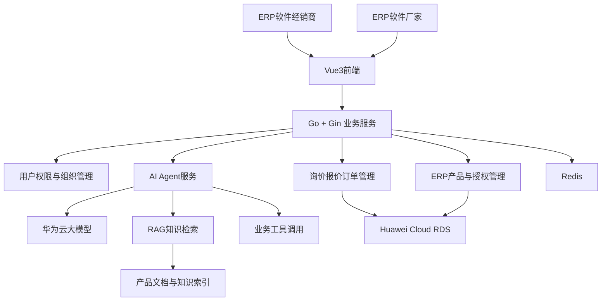

渠智链 AI
======

企业 ERP 软件分销智能协同平台
-----------------

### 产品需求文档（PRD）与技术设计方案

**文档版本：** V1.0  
**项目阶段：** 华为 ICT 大赛赛题1  
**项目类型：** AI 创新应用  
**团队规模：** 2人  
**核心用户：** ERP 软件厂家、ERP 软件经销商  
**核心业务：** 产品查询、需求解析、智能询价、报价协同、订单管理、交付跟踪

* * *

第一章：项目概述
========

1.1 项目背景
--------

企业 ERP 软件分销涉及厂家与经销商之间的产品信息传递、授权规则确认、价格询问、报价协商、订单确认及软件交付等业务环节。

在现有业务模式中，部分业务环节可能依赖微信、电话、Excel、邮件等工具完成，存在以下待验证的问题：

1. 产品资料分散，销售人员需要人工查询产品版本、功能和授权规则。

2. 客户需求表达不规范，厂家需要反复向经销商确认需求。

3. 经销商询价后，需要等待厂家反馈，询价进度不够透明。

4. 报价内容需要人工整理，容易遗漏授权、实施和服务费用。

5. 报价、订单和交付信息分散，难以统一跟踪。

6. 历史询价记录和产品知识难以沉淀、复用。

渠智链 AI 希望通过人工智能和企业协同平台，改善上述业务环节。
1.2 产品定位
--------

打造一个面向 ERP 软件分销产业链的 AI 智能协同平台。

以 AI Agent 为核心，将厂家产品知识、授权政策、询价业务、报价数据和订单流程结合起来，实现从客户需求到软件交付的数字化协同。
1.3 产品核心理念
----------

**让 AI 成为 ERP 软件厂家与经销商之间的业务协作助手，而不是单纯的聊天机器人。**

产品应当具备三个核心能力：

* 理解业务：能够理解客户对 ERP 软件的自然语言需求。

* 辅助决策：能够结合真实产品资料和授权规则提供产品匹配与报价分析。

* 推动业务：能够调用业务接口创建询价、跟踪报价和推进订单流程。

1.4 产品目标
--------

第一阶段目标：

1. 实现厂家和经销商两个角色的在线协作。

2. 建立 ERP 产品、产品版本、功能模块和授权政策知识库。

3. 实现 AI 自然语言需求解析。

4. 实现 AI 产品匹配和询价单生成。

5. 实现厂家在线处理询价和提交报价。

6. 实现报价确认、订单生成和交付跟踪。

7. 将完整应用部署至华为云。

1.5 第一版范围与边界
------------

第一版采取小范围验证策略：

* 优先接入一个有真实业务资料支持的 ERP 厂家或产品体系。

* 支持厂家与经销商直接询价。

* 采用多组织架构，为后续接入其他厂家预留空间。

* 暂时不接入厂家原有 ERP 系统。

* 暂时不实现在线支付、财务结算、复杂佣金和返利计算。

* 暂时不实现软件授权码自动生成，先由厂家人工更新授权交付状态。

* * *

第二章：用户角色与业务场景
=============

2.1 用户角色
--------

第一版设计三个组织类型。

### 角色A：软件厂家

主要职责：

* 管理 ERP 产品及版本。

* 上传产品说明书。

* 管理产品授权政策。

* 接收经销商询价。

* 查看询价需求。

* 进行报价。

* 处理订单。

* 更新软件交付进度。

### 角色B：软件经销商

主要职责：

* 维护客户需求。

* 查询 ERP 产品。

* 使用 AI 解析客户需求。

* 创建并提交询价单。

* 查看厂家报价。

* 请求报价修改。

* 确认报价。

* 生成订单。

* 跟踪订单和交付进度。

### 角色C：平台管理员

主要职责：

* 管理用户和组织。

* 管理平台基础配置。

* 维护系统数据。

* 监控系统运行情况。

平台管理员默认不具有查看厂家商业报价和经销商客户资料的业务权限，特殊运维操作应有授权和审计记录。
2.2 典型业务场景
----------

假设一家制造企业需要采购 ERP 软件。

客户向经销商提出：

> 我们是一家制造企业，大约有120名员工，希望采购一套 ERP 软件，需要财务、采购、库存、销售模块，最好支持私有化部署，还需要数据迁移、系统实施和人员培训。

传统流程可能是：

1. 经销商人工整理客户需求。

2. 查询厂家产品资料。

3. 向厂家询问适合的产品版本。

4. 确认授权数量和授权模式。

5. 等待厂家报价。

6. 整理报价单。

7. 向客户沟通和修改报价。

8. 客户确认后向厂家下单。

9. 厂家安排授权和交付。

渠智链 AI 希望将这套流程整合到一个平台中。
2.3 核心业务流程
----------

客户提出需求  
↓  
经销商录入自然语言需求  
↓  
AI 提取需求字段  
↓  
AI 发现信息缺失并追问  
↓  
经销商确认需求  
↓  
AI 匹配 ERP 产品和版本  
↓  
生成标准询价单  
↓  
经销商提交厂家  
↓  
厂家查看询价并处理  
↓  
厂家填写正式报价  
↓  
AI 检查报价完整性并解释方案  
↓  
经销商确认报价  
↓  
生成销售订单  
↓  
厂家更新授权和实施交付状态  
↓  
业务闭环完成

* * *

第三章：产品功能需求
==========

3.1 功能优先级说明
-----------

* P0：第一版必须完成。

* P1：时间允许时完成。

* P2：后续扩展。

3.2 用户与组织管理
-----------

**优先级：P0**

功能：

1. 用户注册与登录。

2. 用户所属组织管理。

3. 厂家和经销商组织类型区分。

4. 组织成员管理。

5. 基于角色的访问权限。

6. 密码修改与退出登录。

验收标准：

* 厂家用户只能访问自己组织的产品和相关询价。

* 经销商只能访问自己组织的客户、询价和订单。

* 不同组织之间的数据不能相互越权访问。

3.3 ERP 产品中心
------------

**优先级：P0**

产品中心是 AI 能够理解 ERP 业务的基础。

产品信息包括：

| 字段   | 内容              |
| ---- | --------------- |
| 产品名称 | ERP 产品名称        |
| 厂家   | 产品所属厂家          |
| 产品版本 | 标准版、专业版等实际版本    |
| 产品类别 | 财务、供应链、生产管理等    |
| 产品介绍 | 产品主要用途          |
| 功能模块 | 财务、采购、库存、销售等    |
| 部署方式 | 本地部署、私有化部署等     |
| 授权模式 | 按用户数、并发数或其他实际规则 |
| 适用企业 | 产品适用的企业类型       |
| 产品状态 | 上架、下架           |

功能：

* 厂家新增和编辑产品。

* 产品分类管理。

* 产品版本管理。

* 产品功能模块管理。

* 产品详情查看。

* 产品资料上传。

* 产品搜索和筛选。

验收标准：

经销商可以查询产品，并查看自己有权访问的产品介绍、版本、功能模块及授权规则。
3.4 授权政策管理
----------

**优先级：P0**

这是 ERP 软件分销与普通商品分销的重要区别。

厂家需要维护：

* 授权模式。

* 最小授权数量。

* 用户数量限制。

* 并发数量限制。

* 授权期限。

* 产品版本限制。

* 部署方式限制。

* 授权升级规则。

* 续费规则。

* 授权附加条件。

注意：授权规则和商业报价应当分开管理。

授权政策用于判断产品是否满足客户需求；商业价格由厂家报价模块管理。

验收标准：

AI 可以读取有效的授权规则，提示产品匹配过程中存在的授权条件或不确定因素。
3.5 AI 智能需求解析
-------------

**优先级：P0，核心创新功能**

功能描述：

经销商输入自然语言需求，AI 自动提取结构化信息。

需要识别：

| 字段   | 示例          |
| ---- | ----------- |
| 企业类型 | 制造企业        |
| 企业人数 | 120人        |
| 软件类型 | ERP         |
| 所需模块 | 财务、采购、库存、销售 |
| 部署方式 | 私有化部署       |
| 授权数量 | 待确认         |
| 实施服务 | 需要          |
| 数据迁移 | 待确认         |
| 培训服务 | 需要          |
| 预算   | 可选          |
| 交付时间 | 可选          |

AI 应具备：

1. 自然语言理解。

2. 结构化字段提取。

3. 缺失字段识别。

4. 主动追问。

5. 需求总结。

6. 生成询价单草稿。

关键要求：

AI 不允许将推测内容直接当成用户已经确认的需求。

例如，客户有120名员工，不代表一定需要120个 ERP 授权。

AI 应标记为待确认。

验收标准：

输入一段自然语言需求，系统可以生成结构化需求表，并允许经销商人工修改和确认。
3.6 AI 产品智能匹配
-------------

**优先级：P0**

根据需求解析结果，结合产品目录和授权政策，推荐适合的 ERP 产品。

匹配依据：

* 功能模块是否满足。

* 企业规模是否适合。

* 部署方式是否支持。

* 授权模式是否满足。

* 产品版本是否符合要求。

* 实施服务是否可提供。

结果展示：

* 推荐产品。

* 推荐版本。

* 满足的需求。

* 不满足的需求。

* 尚未确认的条件。

* 推荐理由。

* 信息来源。

注意：

AI 推荐不等于厂家正式承诺。对于没有明确产品依据的条件，必须提示待人工确认。
3.7 智能询价管理
----------

**优先级：P0，核心业务功能**

经销商可以创建询价单。

询价单内容：

* 询价编号。

* 客户名称或项目代号。

* 目标厂家。

* 产品及版本。

* 功能模块。

* 授权数量。

* 部署方式。

* 实施服务需求。

* 培训需求。

* 交付时间要求。

* 备注。

* 附件。

功能：

1. AI 生成询价单。

2. 经销商编辑询价单。

3. 提交厂家。

4. 查看询价状态。

5. 查看厂家反馈。

6. 补充需求。

7. 撤回尚未处理的询价。

8. 查询历史询价记录。

询价状态：

* DRAFT：草稿。

* SUBMITTED：已提交。

* PROCESSING：处理中。

* NEED_INFO：需要补充信息。

* QUOTED：已报价。

* CLOSED：已结束。

* CANCELLED：已取消。

3.8 厂家报价管理
----------

**优先级：P0**

厂家可以查看提交给自己的询价单。

功能：

1. 查看客户需求。

2. 查看产品匹配结果。

3. 确认产品和版本。

4. 填写授权价格。

5. 填写实施费用。

6. 填写培训费用。

7. 填写其他服务费用。

8. 设置报价有效期。

9. 填写交付周期。

10. 提交报价。

11. 修改报价并保留版本记录。

报价组成：

* 软件授权费用。

* 实施服务费用。

* 数据迁移费用。

* 培训费用。

* 其他费用。

* 优惠金额。

* 最终报价。

所有金额由厂家人员填写或由经过确认的价格政策计算，不允许 AI 凭空生成价格。

报价状态：

* DRAFT：草稿。

* PENDING_APPROVAL：待审核。

* SENT：已发送。

* ACCEPTED：已接受。

* REJECTED：已拒绝。

* EXPIRED：已过期。

* SUPERSEDED：已被新版本替代。

第一版可以将内部审核简化为厂家报价人员确认，后续再增加复杂审批链。
3.9 AI 报价分析
-----------

**优先级：P1，建议争取完成**

AI 根据客户需求和厂家正式报价进行分析。

功能：

* 检查报价项目是否完整。

* 检查授权数量是否符合需求。

* 对照产品功能要求。

* 解释不同报价项目的用途。

* 提示缺失的服务项目。

* 提醒报价有效期。

* 生成面向客户的报价说明。

AI 不得擅自改变报价金额。
3.10 订单管理
---------

**优先级：P0**

经销商接受厂家报价后生成订单。

订单内容：

* 订单编号。

* 关联询价单。

* 关联报价单。

* 经销商组织。

* 厂家组织。

* 客户项目。

* 产品及授权数量。

* 最终金额。

* 订单状态。

* 创建时间。

订单状态：

* PENDING_CONFIRMATION：待确认。

* CONFIRMED：已确认。

* FULFILLING：交付中。

* PARTIALLY_DELIVERED：部分交付。

* DELIVERED：已交付。

* CLOSED：已完成。

* CANCELLED：已取消。

第一版不需要实现支付功能。
3.11 软件交付管理
-----------

**优先级：P0**

厂家能够更新：

* 授权申请状态。

* 授权发放状态。

* 软件部署状态。

* 数据迁移状态。

* 实施服务状态。

* 培训状态。

* 交付完成情况。

每个订单可以包含多个交付任务。

经销商能够查看交付进度。

第一版采用人工更新状态，不要求自动对接厂家授权服务器。
3.12 消息与协同
----------

**优先级：P1**

支持：

* 询价反馈通知。

* 补充资料通知。

* 报价提交通知。

* 报价即将过期通知。

* 订单状态更新通知。

第一版可以采用站内消息和轮询刷新，不必开发复杂即时通讯系统。

* * *

第四章：AI Agent 设计
===============

4.1 Agent 定位
------------

建议采用单 Agent + 多业务工具的架构。

对于两个人的团队，不建议开发多个复杂 Agent 互相协作。

一个统一的 ERP 分销业务 Agent 已经足够支撑第一版。
4.2 Agent 核心能力
--------------

| 能力     | 实现方式             |
| ------ | ---------------- |
| 需求解析   | 大模型结构化输出         |
| 产品检索   | 数据库检索 + RAG      |
| 授权规则查询 | 产品授权政策检索         |
| 产品匹配   | 规则筛选 + AI 解释     |
| 询价单生成  | Function Calling |
| 报价检查   | 规则校验 + AI 分析     |
| 订单查询   | 后端业务接口           |
| 业务状态解释 | 数据库查询 + 大模型总结    |

4.3 Agent 工具设计
--------------

建议实现以下工具：

**工具1：parse_erp_requirement**

输入：客户自然语言需求。

输出：结构化需求 JSON。

**工具2：search_erp_product**

输入：产品类别、功能模块、部署方式等。

输出：候选产品和产品依据。

**工具3：check_license_policy**

输入：产品版本、授权数量、部署方式。

输出：授权规则检查结果。

**工具4：create_inquiry_draft**

输入：经销商确认后的结构化需求。

输出：询价单草稿。

**工具5：submit_inquiry**

输入：询价单 ID。

输出：提交结果。

必须检查用户权限，并由用户主动确认后调用。

**工具6：get_quotation_detail**

输入：询价单 ID。

输出：厂家报价及版本信息。

**工具7：analyze_quotation**

输入：客户需求与厂家正式报价。

输出：报价分析报告。

**工具8：get_order_status**

输入：订单编号。

输出：订单和交付状态。
4.4 AI 数据处理原则
-------------

AI 输出必须采用结构化 JSON。

示例：
    {  "enterprise_type": "制造企业",  "employee_count": 120,  "software_type": "ERP",  "required_modules": [    "财务",    "采购",    "库存",    "销售"  ],  "deployment_mode": "私有化部署",  "license_count": null,  "implementation_required": true,  "training_required": true,  "missing_fields": [    "实际授权数量",    "是否需要生产制造模块",    "是否需要历史数据迁移"  ],  "need_user_confirmation": true}

以上仅为数据结构示例。

关键规则：

1. AI 不能自行确认未经用户确认的信息。

2. AI 不能自行编造产品功能。

3. AI 不能自行生成正式价格。

4. AI 不能绕过用户权限调用业务接口。

5. AI 不能自动接受报价或提交最终订单。

6. AI 生成的推荐和分析应尽可能附带来源依据。

* * *

第五章：数据库设计
=========

5.1 数据库选型
---------

建议使用：

* MySQL：核心业务数据库。

* 华为云 RDS：云端数据库服务。

* Redis：缓存和会话辅助。

* 文件存储：产品文档、报价附件等。

* 向量检索：后续用于产品知识库 RAG，可根据实际云资源选择实现方式。

采用关系型数据库，避免第一版引入过多复杂技术。
5.2 数据库设计原则
-----------

1. 所有业务数据关联组织 ID。

2. 厂家与经销商数据严格隔离。

3. 所有报价必须保留版本。

4. 重要业务操作必须记录审计日志。

5. 删除业务数据优先采用逻辑删除。

6. 金额字段使用 DECIMAL，不使用浮点数。

7. AI 输出和业务最终数据分开存储。

5.3 核心数据表
---------

### 表1：sys_user（用户表）

| 字段            | 类型           | 说明   |
| ------------- | ------------ | ---- |
| id            | BIGINT       | 主键   |
| username      | VARCHAR(50)  | 登录账号 |
| password_hash | VARCHAR(255) | 密码哈希 |
| real_name     | VARCHAR(50)  | 用户姓名 |
| phone         | VARCHAR(30)  | 联系电话 |
| status        | TINYINT      | 用户状态 |
| created_at    | DATETIME     | 创建时间 |

索引：username 唯一索引。

### 表2：organization（组织表）

| 字段            | 类型           | 说明                      |
| ------------- | ------------ | ----------------------- |
| id            | BIGINT       | 主键                      |
| org_name      | VARCHAR(100) | 组织名称                    |
| org_type      | VARCHAR(30)  | MANUFACTURER / RESELLER |
| contact_name  | VARCHAR(50)  | 联系人                     |
| contact_phone | VARCHAR(30)  | 联系电话                    |
| status        | TINYINT      | 组织状态                    |
| created_at    | DATETIME     | 创建时间                    |

### 表3：org_member（组织成员表）

| 字段         | 类型          | 说明    |
| ---------- | ----------- | ----- |
| id         | BIGINT      | 主键    |
| org_id     | BIGINT      | 组织 ID |
| user_id    | BIGINT      | 用户 ID |
| role_code  | VARCHAR(30) | 组织内角色 |
| created_at | DATETIME    | 加入时间  |

联合唯一索引：org_id + user_id。

### 表4：erp_product（ERP 产品表）

| 字段                  | 类型           | 说明      |
| ------------------- | ------------ | ------- |
| id                  | BIGINT       | 主键      |
| manufacturer_org_id | BIGINT       | 厂家组织 ID |
| product_name        | VARCHAR(150) | 产品名称    |
| product_category    | VARCHAR(50)  | 产品分类    |
| description         | TEXT         | 产品介绍    |
| deployment_modes    | JSON         | 支持部署方式  |
| status              | TINYINT      | 产品状态    |
| created_at          | DATETIME     | 创建时间    |

### 表5：product_version（产品版本表）

| 字段           | 类型           | 说明    |
| ------------ | ------------ | ----- |
| id           | BIGINT       | 主键    |
| product_id   | BIGINT       | 产品 ID |
| version_name | VARCHAR(100) | 版本名称  |
| version_code | VARCHAR(50)  | 版本编号  |
| license_mode | VARCHAR(50)  | 授权模式  |
| status       | TINYINT      | 状态    |

### 表6：product_module（产品功能模块表）

| 字段              | 类型           | 说明   |
| --------------- | ------------ | ---- |
| id              | BIGINT       | 主键   |
| module_name     | VARCHAR(100) | 模块名称 |
| module_category | VARCHAR(50)  | 模块分类 |
| description     | TEXT         | 模块说明 |

### 表7：product_version_module（版本模块关联表）

| 字段         | 类型      | 说明      |
| ---------- | ------- | ------- |
| id         | BIGINT  | 主键      |
| version_id | BIGINT  | 产品版本 ID |
| module_id  | BIGINT  | 模块 ID   |
| included   | TINYINT | 是否包含    |

### 表8：license_policy（授权政策表）

| 字段               | 类型           | 说明      |
| ---------------- | ------------ | ------- |
| id               | BIGINT       | 主键      |
| version_id       | BIGINT       | 产品版本 ID |
| license_mode     | VARCHAR(50)  | 授权模式    |
| min_quantity     | INT          | 最小授权数量  |
| max_quantity     | INT          | 最大授权数量  |
| valid_period     | VARCHAR(50)  | 授权期限    |
| deployment_limit | VARCHAR(100) | 部署限制    |
| policy_content   | JSON         | 详细授权规则  |
| effective_from   | DATETIME     | 生效时间    |
| effective_to     | DATETIME     | 失效时间    |
| status           | TINYINT      | 状态      |

注意：授权政策的可见范围由厂家配置，不是所有经销商都必须看到全部内部政策。

### 表9：customer_project（客户项目表）

| 字段              | 类型           | 说明    |
| --------------- | ------------ | ----- |
| id              | BIGINT       | 主键    |
| reseller_org_id | BIGINT       | 所属经销商 |
| customer_name   | VARCHAR(150) | 客户名称  |
| project_name    | VARCHAR(150) | 项目名称  |
| industry        | VARCHAR(50)  | 所属行业  |
| employee_count  | INT          | 企业人数  |
| remark          | TEXT         | 备注    |
| created_at      | DATETIME     | 创建时间  |

客户联系人和敏感联系方式建议单独加密存储，不作为跨组织共享字段。

### 表10：inquiry（询价单表）

这是整个系统最重要的业务表之一。

| 字段                  | 类型            | 说明      |
| ------------------- | ------------- | ------- |
| id                  | BIGINT        | 主键      |
| inquiry_no          | VARCHAR(50)   | 询价编号    |
| reseller_org_id     | BIGINT        | 经销商 ID  |
| manufacturer_org_id | BIGINT        | 厂家 ID   |
| customer_project_id | BIGINT        | 客户项目 ID |
| created_by          | BIGINT        | 创建人     |
| inquiry_title       | VARCHAR(200)  | 询价标题    |
| requirement_summary | TEXT          | 需求摘要    |
| deployment_mode     | VARCHAR(50)   | 部署方式    |
| expected_budget     | DECIMAL(12,2) | 预算      |
| status              | VARCHAR(30)   | 询价状态    |
| submitted_at        | DATETIME      | 提交时间    |
| created_at          | DATETIME      | 创建时间    |

索引：

* inquiry_no 唯一。

* reseller_org_id + status。

* manufacturer_org_id + status。

* created_at。

### 表11：inquiry_requirement（询价需求明细表）

| 字段          | 类型           | 说明        |
| ----------- | ------------ | --------- |
| id          | BIGINT       | 主键        |
| inquiry_id  | BIGINT       | 询价单 ID    |
| field_key   | VARCHAR(100) | 字段名称      |
| field_value | JSON         | 字段值       |
| confidence  | DECIMAL(5,4) | AI 置信度    |
| source_type | VARCHAR(30)  | 用户输入/AI提取 |
| confirmed   | TINYINT      | 是否人工确认    |

这个表用于记录 AI 解析结果及用户确认状态。

### 表12：inquiry_message（询价沟通记录表）

| 字段             | 类型          | 说明     |
| -------------- | ----------- | ------ |
| id             | BIGINT      | 主键     |
| inquiry_id     | BIGINT      | 询价单 ID |
| sender_org_id  | BIGINT      | 发送组织   |
| sender_user_id | BIGINT      | 发送人    |
| message_type   | VARCHAR(30) | 消息类型   |
| content        | TEXT        | 内容     |
| created_at     | DATETIME    | 创建时间   |

用于记录补充需求、厂家反馈和询价沟通。

### 表13：quotation（报价单表）

| 字段                  | 类型            | 说明     |
| ------------------- | ------------- | ------ |
| id                  | BIGINT        | 主键     |
| quotation_no        | VARCHAR(50)   | 报价编号   |
| inquiry_id          | BIGINT        | 询价单 ID |
| manufacturer_org_id | BIGINT        | 厂家 ID  |
| reseller_org_id     | BIGINT        | 经销商 ID |
| version_no          | INT           | 报价版本   |
| subtotal            | DECIMAL(12,2) | 小计     |
| discount_amount     | DECIMAL(12,2) | 优惠金额   |
| total_amount        | DECIMAL(12,2) | 总价     |
| valid_until         | DATETIME      | 有效期    |
| status              | VARCHAR(30)   | 报价状态   |
| created_by          | BIGINT        | 创建人    |
| created_at          | DATETIME      | 创建时间   |

报价版本应保留历史记录，不能直接覆盖已经发送的旧版本。

### 表14：quotation_item（报价明细表）

| 字段              | 类型            | 说明           |
| --------------- | ------------- | ------------ |
| id              | BIGINT        | 主键           |
| quotation_id    | BIGINT        | 报价单 ID       |
| item_name       | VARCHAR(150)  | 项目名称         |
| item_type       | VARCHAR(50)   | 软件/授权/实施/培训等 |
| quantity        | DECIMAL(12,2) | 数量           |
| unit            | VARCHAR(30)   | 单位           |
| unit_price      | DECIMAL(12,2) | 单价           |
| discount_amount | DECIMAL(12,2) | 优惠金额         |
| total_price     | DECIMAL(12,2) | 合计           |
| remark          | TEXT          | 备注           |

### 表15：sales_order（销售订单表）

| 字段                  | 类型            | 说明     |
| ------------------- | ------------- | ------ |
| id                  | BIGINT        | 主键     |
| order_no            | VARCHAR(50)   | 订单编号   |
| inquiry_id          | BIGINT        | 询价单 ID |
| quotation_id        | BIGINT        | 报价单 ID |
| manufacturer_org_id | BIGINT        | 厂家 ID  |
| reseller_org_id     | BIGINT        | 经销商 ID |
| total_amount        | DECIMAL(12,2) | 订单金额   |
| status              | VARCHAR(30)   | 订单状态   |
| created_at          | DATETIME      | 创建时间   |

### 表16：order_item（订单明细表）

| 字段                 | 类型            | 说明      |
| ------------------ | ------------- | ------- |
| id                 | BIGINT        | 主键      |
| order_id           | BIGINT        | 订单 ID   |
| product_version_id | BIGINT        | 产品版本 ID |
| item_name          | VARCHAR(150)  | 商品项目    |
| quantity           | DECIMAL(12,2) | 数量      |
| unit_price         | DECIMAL(12,2) | 单价      |
| total_price        | DECIMAL(12,2) | 合计      |

### 表17：delivery_task（交付任务表）

| 字段                  | 类型           | 说明          |
| ------------------- | ------------ | ----------- |
| id                  | BIGINT       | 主键          |
| order_id            | BIGINT       | 订单 ID       |
| task_name           | VARCHAR(150) | 任务名称        |
| task_type           | VARCHAR(50)  | 授权/部署/迁移/培训 |
| status              | VARCHAR(30)  | 任务状态        |
| responsible_user_id | BIGINT       | 负责人         |
| remark              | TEXT         | 备注          |
| updated_at          | DATETIME     | 更新时间        |

### 表18：attachment（附件表）

| 字段            | 类型           | 说明     |
| ------------- | ------------ | ------ |
| id            | BIGINT       | 主键     |
| business_type | VARCHAR(50)  | 所属业务类型 |
| business_id   | BIGINT       | 业务 ID  |
| file_name     | VARCHAR(255) | 文件名称   |
| file_url      | VARCHAR(500) | 文件存储地址 |
| file_type     | VARCHAR(30)  | 文件类型   |
| uploaded_by   | BIGINT       | 上传人    |
| created_at    | DATETIME     | 上传时间   |

### 表19：knowledge_document（知识文档表）

| 字段                  | 类型           | 说明            |
| ------------------- | ------------ | ------------- |
| id                  | BIGINT       | 主键            |
| manufacturer_org_id | BIGINT       | 所属厂家          |
| product_id          | BIGINT       | 关联产品          |
| document_name       | VARCHAR(200) | 文档名称          |
| document_type       | VARCHAR(50)  | 产品手册/授权政策/FAQ |
| file_url            | VARCHAR(500) | 文件地址          |
| version_no          | VARCHAR(50)  | 文档版本          |
| effective_from      | DATETIME     | 生效时间          |
| effective_to        | DATETIME     | 失效时间          |
| status              | TINYINT      | 状态            |

文档切片和向量索引可以在后续知识库实现中维护，不必在第一版自行开发复杂的向量管理系统。

### 表20：ai_task_log（AI 任务记录表）

| 字段            | 类型           | 说明      |
| ------------- | ------------ | ------- |
| id            | BIGINT       | 主键      |
| user_id       | BIGINT       | 用户 ID   |
| org_id        | BIGINT       | 组织 ID   |
| task_type     | VARCHAR(50)  | AI 任务类型 |
| input_summary | TEXT         | 输入摘要    |
| output_data   | JSON         | AI 输出   |
| model_name    | VARCHAR(100) | 模型名称    |
| status        | VARCHAR(30)  | 执行状态    |
| created_at    | DATETIME     | 创建时间    |

### 表21：audit_log（业务审计表）

| 字段            | 类型          | 说明    |
| ------------- | ----------- | ----- |
| id            | BIGINT      | 主键    |
| org_id        | BIGINT      | 操作组织  |
| user_id       | BIGINT      | 操作用户  |
| business_type | VARCHAR(50) | 业务类型  |
| business_id   | BIGINT      | 业务 ID |
| action        | VARCHAR(50) | 操作行为  |
| old_value     | JSON        | 操作前数据 |
| new_value     | JSON        | 操作后数据 |
| created_at    | DATETIME    | 操作时间  |

5.4 数据库核心关系
-----------

    erDiagram    ORGANIZATION ||--o{ ORG_MEMBER : contains    SYS_USER ||--o{ ORG_MEMBER : joins    ORGANIZATION ||--o{ ERP_PRODUCT : owns    ERP_PRODUCT ||--o{ PRODUCT_VERSION : has    PRODUCT_VERSION ||--o{ LICENSE_POLICY : follows    PRODUCT_VERSION ||--o{ PRODUCT_VERSION_MODULE : includes    PRODUCT_MODULE ||--o{ PRODUCT_VERSION_MODULE : maps    ORGANIZATION ||--o{ CUSTOMER_PROJECT : owns    CUSTOMER_PROJECT ||--o{ INQUIRY : generates    INQUIRY ||--o{ INQUIRY_REQUIREMENT : contains    INQUIRY ||--o{ INQUIRY_MESSAGE : has    INQUIRY ||--o{ QUOTATION : receives    QUOTATION ||--o{ QUOTATION_ITEM : contains    QUOTATION ||--o| SALES_ORDER : creates    SALES_ORDER ||--o{ ORDER_ITEM : contains    SALES_ORDER ||--o{ DELIVERY_TASK : tracks

说明：

* 一个厂家可以拥有多个 ERP 产品。

* 一个 ERP 产品可以有多个版本。

* 一个版本可以包含多个功能模块。

* 一个经销商可以创建多个客户项目。

* 一个客户项目可以对应多笔询价。

* 一笔询价可以有多个报价版本。

* 被接受的报价可以生成一笔订单。

* 一笔订单可以有多个交付任务。

5.5 第一版建表顺序
-----------

建议按照依赖关系开发：

1. organization

2. sys_user

3. org_member

4. erp_product

5. product_version

6. product_module

7. product_version_module

8. license_policy

9. customer_project

10. inquiry

11. inquiry_requirement

12. inquiry_message

13. quotation

14. quotation_item

15. sales_order

16. order_item

17. delivery_task

18. attachment

19. knowledge_document

20. ai_task_log

21. audit_log

以上是完整设计。实际第一版可以分阶段建表，不需要一次全部实现。

* * *

第六章：系统技术架构
==========

6.1 技术选型
--------

| 层级    | 推荐技术                     | 作用      |
| ----- | ------------------------ | ------- |
| 前端    | Vue 3                    | 页面开发    |
| UI    | Element Plus             | 管理后台组件  |
| 后端    | Go + Gin                 | REST 业务接口与中间件 |
| ORM   | GORM                     | MySQL 数据访问与事务 |
| 数据库   | MySQL / 华为云 RDS          | 业务数据    |
| 缓存    | Redis                    | 缓存、会话   |
| AI    | 华为云 MaaS                 | 大模型能力   |
| AI 编排 | Agent + Function Calling | 业务智能体   |
| 知识库   | RAG                      | 产品资料检索  |
| 文件管理  | 云端文件存储                   | 文档和附件   |
| 开发工具  | CodeArts 代码智能体           | AI 辅助开发 |
| 部署    | 华为云支持的云计算资源              | 应用上线    |

注意：

具体模型、RAG 服务和云端文件存储产品，需要以你们实际获得的华为云资源和权限为准。
6.2 系统架构
--------

6.3 架构建议
--------

第一版采用模块化单体架构，不使用微服务。

原因：

* 团队只有两人。

* 业务规模尚小。

* 业务流程仍在验证。

* 微服务会增加部署和联调成本。

先把业务模块边界设计好，后续再拆分服务。

* * *

第七章：后端 API 设计
=============

建议统一采用 RESTful API。

统一返回格式：
    {  "code": 200,  "message": "success",  "data": {}}
7.1 用户与组织
---------

| 方法   | 接口                 | 功能     |
| ---- | ------------------ | ------ |
| POST | /api/auth/login    | 登录     |
| POST | /api/auth/register | 注册     |
| GET  | /api/user/profile  | 获取用户信息 |
| GET  | /api/org/current   | 获取当前组织 |

7.2 产品管理
--------

| 方法   | 接口                          | 功能     |
| ---- | --------------------------- | ------ |
| GET  | /api/products               | 产品列表   |
| POST | /api/products               | 新增产品   |
| GET  | /api/products/{id}          | 产品详情   |
| PUT  | /api/products/{id}          | 编辑产品   |
| GET  | /api/products/{id}/policies | 获取授权政策 |

7.3 AI 服务
---------

| 方法   | 接口                        | 功能      |
| ---- | ------------------------- | ------- |
| POST | /api/ai/parse-requirement | AI 解析需求 |
| POST | /api/ai/match-products    | 产品智能匹配  |
| POST | /api/ai/check-license     | 授权规则检查  |
| POST | /api/ai/analyze-quotation | AI 报价分析 |

7.4 询价管理
--------

| 方法   | 接口                           | 功能     |
| ---- | ---------------------------- | ------ |
| POST | /api/inquiries               | 创建询价   |
| GET  | /api/inquiries               | 询价列表   |
| GET  | /api/inquiries/{id}          | 询价详情   |
| POST | /api/inquiries/{id}/submit   | 提交询价   |
| POST | /api/inquiries/{id}/messages | 发送沟通消息 |
| PUT  | /api/inquiries/{id}/status   | 更新询价状态 |

7.5 报价管理
--------

| 方法   | 接口                          | 功能     |
| ---- | --------------------------- | ------ |
| POST | /api/quotations             | 创建报价   |
| GET  | /api/quotations/{id}        | 报价详情   |
| PUT  | /api/quotations/{id}        | 编辑报价草稿 |
| POST | /api/quotations/{id}/send   | 发送报价   |
| POST | /api/quotations/{id}/accept | 接受报价   |
| POST | /api/quotations/{id}/reject | 拒绝报价   |

7.6 订单与交付
---------

| 方法   | 接口                              | 功能      |
| ---- | ------------------------------- | ------- |
| POST | /api/orders/from-quotation/{id} | 从报价生成订单 |
| GET  | /api/orders                     | 订单列表    |
| GET  | /api/orders/{id}                | 订单详情    |
| GET  | /api/orders/{id}/delivery       | 获取交付进度  |
| POST | /api/delivery/tasks             | 创建交付任务  |
| PUT  | /api/delivery/tasks/{id}        | 更新交付任务  |

所有接口都必须执行组织权限校验，不能只依赖前端隐藏按钮。

* * *

第八章：安全与可靠性要求
============

8.1 多租户数据隔离
-----------

每笔业务数据都需要绑定：

* 经销商组织 ID。

* 厂家组织 ID。

* 创建人 ID。

所有业务接口都要检查当前用户是否有权访问对应数据。
8.2 商业数据保护
----------

以下数据应作为敏感数据处理：

* 厂家底价。

* 经销商采购价格。

* 客户联系方式。

* 特殊折扣政策。

* 商业合同和报价附件。

不同组织只能访问授权范围内的数据。
8.3 AI 安全
---------

* AI 不可以自行决定最终报价。

* AI 不可以绕过权限系统。

* AI 不可以擅自提交正式订单。

* AI 不可以将一个厂家的内部价格泄露给其他经销商。

* AI 读取的文档必须经过权限过滤。

* AI 输出不能直接替代业务审批。

8.4 业务可靠性
---------

* 订单必须关联有效报价。

* 已发送报价不能直接覆盖。

* 报价修改必须生成新版本。

* 已接受报价的金额不能被 AI 自动修改。

* 重要业务状态变化必须有日志。

* 过期报价不能直接生成新订单。

* * *

第九章：两人团队开发任务分工
==============

这是我认为最需要认真设计的部分。

两个人不能按照传统大团队的方式拆分工作，否则很容易出现接口不统一、前后端反复等待和 AI 模块无法集成的问题。

建议采用：

**mayisuix 负责后端、AI 与华为云部署。**

**wweijie473-boop 负责前端、产品交互、ERP 资料与比赛演示。**

两人共同负责产品调研、CodeArts 使用、集成测试和比赛材料。

任务编号、前置依赖和验收标准见 [Clerk 开发计划](.clerk/roadmap.md)。

9.1 mayisuix｜后端与 AI
--------------

主要职责：

### 后端基础

* Go + Gin 项目搭建，使用 GORM 访问 MySQL，并通过版本化 SQL 管理数据库迁移。

* MySQL 数据库设计与实现。

* Redis 配置。

* 登录与权限系统。

* 多组织数据隔离。

* 产品管理接口。

* 询价、报价、订单接口。

### AI 功能

* 华为云大模型接入。

* 需求解析 Prompt。

* 结构化 JSON 输出。

* 产品知识库检索。

* 产品匹配算法。

* 授权规则检查。

* Agent 工具调用。

* AI 报价分析。

### 云端部署

* RDS 配置。

* Redis 配置。

* 后端部署。

* 接口测试。

* 云端日志和异常排查。

交付物：

1. 后端源码。

2. 数据库 SQL。

3. API 接口文档。

4. AI Agent 服务。

5. 华为云部署说明。

9.2 wweijie473-boop｜前端与产品
-------------

主要职责：

### 产品设计

* 用户调研。

* 业务流程整理。

* PRD 编写。

* 页面原型设计。

* 用户角色和交互设计。

### 前端开发

* 登录注册页面。

* 厂家工作台。

* 经销商工作台。

* ERP 产品中心。

* AI 需求解析页面。

* 询价管理页面。

* 报价管理页面。

* 订单管理页面。

* 交付进度页面。

* 数据看板。

### 数据准备

* 产品资料整理。

* 产品分类和功能模块录入。

* 授权政策整理。

* 历史询价数据脱敏。

* 测试案例准备。

### 比赛展示

* Demo 流程设计。

* 页面美化。

* 演示数据准备。

* 项目介绍材料。

* 操作说明文档。

交付物：

1. 前端源码。

2. 页面原型。

3. 产品知识数据。

4. 测试用例。

5. Demo 演示材料。

9.3 两人共同负责
----------

以下任务不建议只交给其中一人：

| 任务          | mayisuix | wweijie473-boop |
| ----------- | ----- | ------- |
| 行业调研        | 共同    | 共同      |
| 产品需求分析      | 技术可行性 | 业务流程    |
| CodeArts 使用 | 共同    | 共同      |
| 前后端联调       | 接口支持  | 页面联调    |
| 系统测试        | 后端测试  | 前端与业务测试 |
| 云端验收        | 主负责   | 配合      |
| 作品答辩        | 技术部分  | 产品部分    |
| 开源文档        | 部署说明  | 使用说明    |

建议每个接口先确定请求和返回格式，再进行前后端并行开发。

* * *

第十章：开发阶段规划
==========

对于两个人的团队，我建议按以下五个阶段推进。
阶段一：真实业务调研与需求冻结
---------------

主要任务：

1. 访问真实 ERP 软件经销商。

2. 了解厂家询价流程。

3. 整理真实询价单。

4. 整理厂家报价单。

5. 整理产品目录。

6. 整理授权政策。

7. 确定产品字段和数据库结构。

验收结果：

形成一套经过真实业务人员确认的业务流程和测试资料。
阶段二：基础业务平台开发
------------

主要任务：

1. 用户登录和组织管理。

2. 产品管理。

3. 产品版本和功能模块管理。

4. 授权政策管理。

5. 询价管理。

6. 报价管理。

7. 订单管理。

验收结果：

即使不使用 AI，也能完成一笔完整的询价和订单业务。
阶段三：AI 核心能力开发
-------------

主要任务：

1. 大模型接入。

2. 需求解析。

3. 缺失字段识别。

4. 产品智能匹配。

5. 授权政策查询。

6. AI 询价单生成。

7. 报价分析。

验收结果：

AI 可以真正参与询价和报价流程，而不是只有聊天功能。
阶段四：华为云部署与系统测试
--------------

主要任务：

1. 配置 RDS。

2. 配置 Redis。

3. 完成云端部署。

4. 测试组织权限隔离。

5. 测试业务流程。

6. 测试 AI 输出准确性。

7. 修复 Bug。

验收结果：

可以通过公网访问完整 Demo，能够稳定完成核心业务闭环。
阶段五：比赛材料和答辩
-----------

主要任务：

1. 整理项目介绍。

2. 绘制系统架构图。

3. 整理创新点。

4. 准备演示数据。

5. 录制演示视频。

6. 整理开源代码。

7. 编写 README。

8. 编写部署文档。

9. 整理 CodeArts 开发过程记录。

验收结果：

项目能够演示、部署、复现和开源。

* * *

第十一章：比赛 Demo 设计
===============

建议设计一个3～5分钟的演示流程。
演示场景
----

某制造企业需要购买 ERP 软件。

### 第一幕：经销商录入需求

输入：

我们是一家制造企业，有120名员工，需要 ERP 软件，包含财务、采购、库存、销售，要求私有化部署，需要实施培训。

展示：

AI 自动提取需求，识别缺失字段，并主动询问。

### 第二幕：AI 产品匹配

展示：

系统根据真实产品目录和授权规则，推荐符合条件的产品。

展示推荐依据和待确认事项。

### 第三幕：生成询价单

经销商确认需求后，AI 自动生成标准询价单。

点击提交。

### 第四幕：厂家处理询价

切换厂家账号。

展示：

厂家收到询价任务，查看需求、填写授权数量、软件费用、实施费用和交付周期。

提交正式报价。

### 第五幕：AI 分析报价

切换回经销商账号。

展示：

AI 自动分析报价完整性，检查授权条件，解释报价构成。

### 第六幕：生成订单

经销商确认报价。

系统生成订单。

厂家更新授权和实施进度。

### 第七幕：业务数据看板

展示：

* 询价总量。

* 待处理询价。

* 已报价数量。

* 已确认订单。

* 订单交付进度。

最终展示完整的业务闭环。

* * *

第十二章：项目创新点总结
============

建议正式比赛材料围绕三个创新点展开。
创新点一：ERP 行业专用 AI 需求理解引擎
-----------------------

区别于普通 AI 问答系统，平台结合 ERP 产品知识、功能模块和授权规则，能够将非结构化客户需求转换成标准化询价数据。
创新点二：面向厂家与经销商的 AI 询报价协同机制
-------------------------

将原本分散的询价、需求补充、报价反馈和订单确认整合到统一业务流程。

AI 能够识别业务状态、发现信息缺失并调用经过授权的业务工具。
创新点三：具有依据追踪能力的可信报价辅助系统
----------------------

将产品资料、授权政策、厂家报价和服务费用进行关联。

AI 能够辅助分析报价，但正式价格以厂家确认的数据为准，实现业务过程可追溯。

* * *

第十三章：项目风险与待验证事项
===============

在正式开发前，建议完成以下验证。

| 待验证事项          | 验证方法         |
| -------------- | ------------ |
| 经销商是否确实频繁向厂家询价 | 访谈销售人员       |
| 询价单是否存在统一格式    | 收集真实询价单      |
| 厂家是否愿意在线处理询价   | 访谈厂家业务人员     |
| 厂家是否愿意共享产品资料   | 获取授权         |
| 授权政策是否可以结构化    | 分析真实政策文件     |
| 报价是否经常需要修改     | 分析历史报价       |
| 经销商是否愿意使用平台    | 邀请试用         |
| AI 是否能准确识别需求   | 使用脱敏历史询价进行测试 |

建议准备10～20条脱敏历史询价案例，作为第一批测试集。

评价：

1. 字段提取准确率。

2. 必要字段识别准确率。

3. 缺失信息识别情况。

4. 产品匹配结果的正确性。

5. 报价分析是否符合真实数据。

6. 人工整理询价单与 AI 辅助整理的耗时差异。

所有指标应通过实际测试获得，不要在比赛材料中提前编造效果数据。

* * *

第十四章：最终 MVP 验收标准
================

第一版产品完成时，至少应满足以下条件：

* 厂家和经销商能够分别登录。

* 不同组织之间的数据权限隔离正常。

* 厂家能够维护 ERP 产品和授权政策。

* 经销商能够录入客户需求。

* AI 能够将自然语言转化为结构化需求。

* AI 能够识别缺失信息。

* AI 能够根据真实产品资料进行产品匹配。

* 经销商能够生成和提交询价单。

* 厂家能够处理询价。

* 厂家能够创建正式报价。

* 经销商能够查看和确认报价。

* 报价修改能够保留历史版本。

* 系统能够根据有效报价生成订单。

* 厂家能够更新交付进度。

* AI 不会擅自修改正式价格和提交订单。

* 项目能够部署在华为云。

* 项目能够提供可视化在线 Demo。

* 项目具备完整的源码、部署说明和使用文档。

* * *

最终产品定义
======

**渠智链 AI——面向 ERP 软件分销产业链的智能询报价与订单协同平台。**

以 ERP 行业知识为基础，以 AI Agent 为核心，以厂家和经销商的业务协作为主线，实现从客户需求理解、产品匹配、智能询价、厂家报价到订单交付的完整数字化流程。

项目的核心目标不是替代现有 ERP 系统，而是解决厂家与经销商之间的跨组织协作问题。

**项目核心口号：让每一笔软件采购需求，都能被 AI 理解、被渠道快速响应、被业务全程追踪。**
